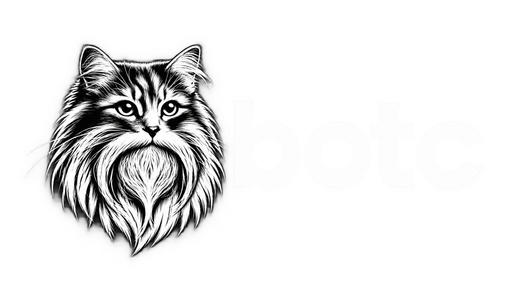

# botc

**botc** is a conversational Discord bot designed to join in naturally. It monitors conversations and uses a [decision prompt](doc/configuration.md#optional) to decide when to engage, rather than waiting only for an @-mention or reply. It can also research topics, understand images and voice messages, and create or edit images.

My intent is for **botc** to engage with chat users in a more human-like fashion. It brings together ideas from my [previous Discord bot projects](#history) with newer ways of using LLMs.

**botc** currently uses the OpenAI API for prompt completions, with the possibility of adding other APIs and local LLMs. It is written in TypeScript for Node.js, runs on [Discord.js](https://github.com/discordjs/discord.js), and uses the [openai-node](https://github.com/openai/openai-node) SDK.

## Contents

- [Features](#features)
- [Data Handling](#data-handling)
- [Configuration](#configuration)
- [History](#history)
- [License](#license)

## Features

- **Conversation-aware replies:** Always responds to @-mentions and direct messages, and uses a configurable decision prompt to join ongoing conversations when it has something useful to add.
- **Reply context:** Uses recent channel history and the message being replied to, so responses stay grounded in the conversation.
- **Personalized responses:** Builds a cached profile for each engaged user from their server history.
- **Image and voice understanding:** Describes image attachments and transcribes voice messages for use as conversation context. Results are cached to avoid repeat processing.
- **Web grounding (optional):** Uses Brave AI Grounding to bring current information into a response when it would help.
- **Image creation and editing:** Generates images from prompts and edits images attached to a message or the message it replies to, using the configured OpenAI image model.
- **Voice replies (optional):** Replies to voice messages with speech generated by ElevenLabs.

Web grounding and voice replies are disabled by default and require their provider credentials. See [Configuration](#configuration) for setup details.

## Data Handling

botc uses recent Discord conversation history to decide when to respond and to generate replies. Depending on the message, it sends OpenAI message text and context such as usernames, channel names, timestamps, and reply content. It may also send image attachments for description or editing, voice audio for transcription, and a user's server history to create a personalized summary.

When AI grounding is enabled and selected for a response, botc sends Brave a search query generated from the conversation context. When voice responses are enabled and used, botc sends the generated reply text to ElevenLabs for speech synthesis.

Image descriptions, voice transcriptions, and user summaries are held in in-memory caches with configurable expiration times; restarting botc clears these caches. Enabling `ENABLE_DEBUG_LOGGING` writes detailed OpenAI request payloads and responses to standard logs, which may be retained by your container platform.

This section describes botc's data flows, not provider retention practices. Operators supply their own provider keys and should review the applicable provider terms and settings for their accounts.

[View Changelog](doc/CHANGELOG.md)

## Configuration

Configuration is achieved through environment variables, which are easily configured for container deployments. Detailed documentation [here](doc/configuration.md).

## History

**botc** grew out of two earlier Discord bot projects, each a different kind of experiment.

### [discord-bot-ol-bootsie](https://github.com/jlyons210/discord-bot-ol-bootsie) ("dbob", archived)

I started dbob in early 2023 while learning TypeScript and figuring out how to work with LLMs. It kept evolving for about 18 months before I retired it.

The name has a couple of personal roots: `botc` sounds a bit like Bootsie, one of my cats who passed away about a decade ago, and it started as shorthand for "bot-container" when I containerized dbob. I also ran two dbob instances with personas inspired by my cats Boots and Manky.

### [envoy-ai](https://github.com/jlyons210/envoy-ai-interest) (incomplete proof-of-concept, archived)

In late 2023, I started envoy-ai to rebuild dbob around an event-based architecture. It was over-engineered and never finished, so I set it aside after about three months. Even so, I remain prouder of its code than dbob's.

## License

This project is released under the Unlicense. See the [LICENSE](LICENSE) file.
